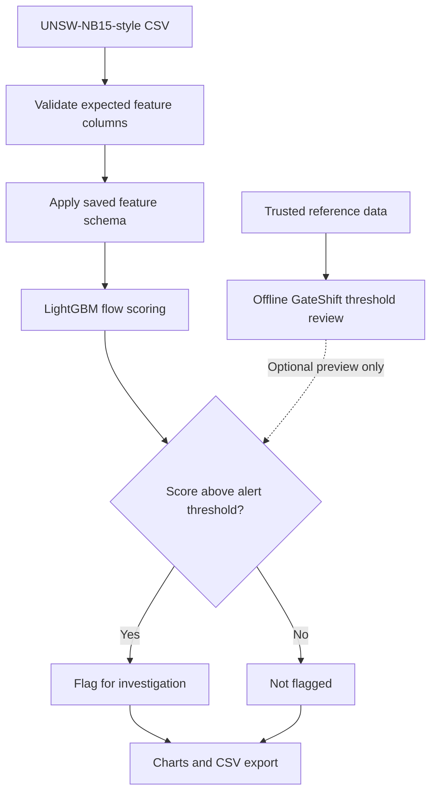

# ZeroGuard AI

**Network threat analytics with machine learning and controlled alert adaptation**

[](https://zeroguard-ai.streamlit.app/)
[](https://www.python.org/)
[](https://research.unsw.edu.au/projects/unsw-nb15-dataset)

**[Launch ZeroGuard AI](https://zeroguard-ai.streamlit.app/)** · **[Source code](https://github.com/raihan-sk/ZeroGuard-AI)**

## Overview

ZeroGuard AI is a machine-learning-based network-flow analysis application. It scores structured traffic records for attack-like behavior, highlights flows that warrant investigation, and lets users inspect and export the results through an interactive Streamlit interface.

Alongside the application, the project investigates **GateShift**, a guarded threshold-adaptation method intended to reduce false alarms when benign traffic distributions change without excessively sacrificing attack detection.

**Scope:** the deployed app analyzes uploaded, prepared UNSW-NB15-style CSV files. It is **not** a live packet sniffer, exploit identifier, or production intrusion-prevention system. A flagged flow is an investigation lead, not proof of an attack.

## Features

- **Batch network-flow analysis:** upload a CSV of traffic records and obtain detection scores and investigation flags.
- **Traffic analytics:** view flagged shares, score distributions, protocol summaries, and flow-level results.
- **Alert investigation:** inspect suspicious records and export scored CSV data.
- **Adaptive alert demonstration:** preview controlled threshold changes using trusted reference data, without silently changing the deployed baseline.
- **Small deployment model:** the saved LightGBM model bundle is approximately 265 KB.

## How it works



The model produces an **attack-suspicion score**, not a calibrated probability that a specific real-world exploit occurred.

## Data and research design

The experiments use the **UNSW-NB15** network intrusion dataset. For open-set evaluation, one named attack family is excluded from model training and threshold tuning at a time; its detection recall is then measured on withheld development records. The project also tests **simulated shifts in benign traffic**.

Approaches investigated:

1. Supervised LightGBM baseline.
2. Benign-only Isolation Forest anomaly detector.
3. Fixed weighted hybrid of LightGBM and Isolation Forest.
4. Frozen threshold, unconditional adaptation, KS-triggered adaptation, and **GateShift v2**, which restricts threshold adjustment using a known-attack recall guard.

### Nine-family development results

Results below are **means over nine held-out attack-family experiments under simulated benign shift**, **not** independent production measurements or pooled recall over all attack records.

| Approach | Benign false-positive rate | Recall on withheld attack family | Known-attack recall |
|---|---:|---:|---:|
| Frozen LightGBM | 2.47% | **80.76%** | **87.58%** |
| Always adapt | **1.14%** | 66.86% | 83.72% |
| KS-only adaptation | 1.30% | 67.05% | 84.01% |
| GateShift v2 | 1.89% | 78.45% | 86.06% |

**Interpretation:** compared with a frozen threshold, GateShift v2 reduced the average benign false-positive rate from 2.47% to 1.89% while reducing average withheld-family recall from 80.76% to 78.45%. This is a **trade-off**, not an across-the-board improvement. In particular, Fuzzers recall was low (14.38%) in the GateShift v2 simulated-shift experiment. The evaluation known-recall guard was exceeded in four of the nine family runs despite being satisfied on the separate guard split.

The official UNSW-NB15 test partition was inspected in earlier baseline experiments. Therefore, the project should not describe that partition as a pristine independent final holdout. Further validation across genuinely separate traffic environments and unseen attack families is needed before making generalization claims.

## Run locally

Requirements: **Python 3.11** and a trusted copy of the saved model bundle.

```bash
# Clone the repository
git clone https://github.com/raihan-sk/ZeroGuard-AI.git
cd ZeroGuard-AI

# Create a virtual environment
python3.11 -m venv .venv
source .venv/bin/activate  # macOS/Linux

# Install Python dependencies
python -m pip install -r requirements.txt

# Launch the app
python -m streamlit run dashboard/app.py
```

Then open **http://localhost:8501**. On Linux, LightGBM may additionally need the OpenMP runtime declared in `packages.txt`; on macOS, install the appropriate OpenMP runtime if required.

### Upload format

Use a prepared **UNSW-NB15-style CSV** with the same 42 input feature columns expected by the saved model. Label columns, when present, are optional metadata for evaluation; they are not model input features.

The app currently processes the first **10,000 rows** and enforces a **25 MB upload limit in its own processing logic**. Avoid uploading sensitive or proprietary network data to a public hosted demo.

## Repository layout

```text
ZeroGuard-AI/
├── .streamlit/                 # Streamlit configuration
├── dashboard/app.py           # Web interface
├── src/zeroguard_engine.py    # Inference and adaptation utilities
├── models/zeroguard_deploy.joblib
├── requirements.txt
├── packages.txt
└── README.md
```

Additional development notebooks, raw datasets, and intermediate evaluation artifacts are not part of the minimal cloud-deployment bundle.

## Technology

Python · Pandas · NumPy · scikit-learn · LightGBM · Streamlit · Plotly / Altair · Joblib

## Limitations and next steps

- Current application is **batch CSV inference**, not continuous real-time network monitoring.
- Unknown-attack experiments approximate *unseen attack families*; they do **not** demonstrate universal zero-day exploit detection.
- Threshold calibration and drift adaptation require careful, leakage-free validation in each new environment.
- The adaptation safeguard limits recall loss on a trusted guard split but does not guarantee identical performance on other traffic.
- Planned research: independent cross-dataset validation, more realistic temporal drift tests, per-family confidence intervals, and improved detection of difficult families such as Fuzzers.

## Dataset acknowledgment

Research dataset: **UNSW-NB15**, UNSW Canberra Cyber. [Dataset and documentation](https://research.unsw.edu.au/projects/unsw-nb15-dataset).

## Live demo

**https://zeroguard-ai.streamlit.app/**

The live site is a research-oriented network threat analytics demonstration; it should not be relied upon as a standalone security control.
