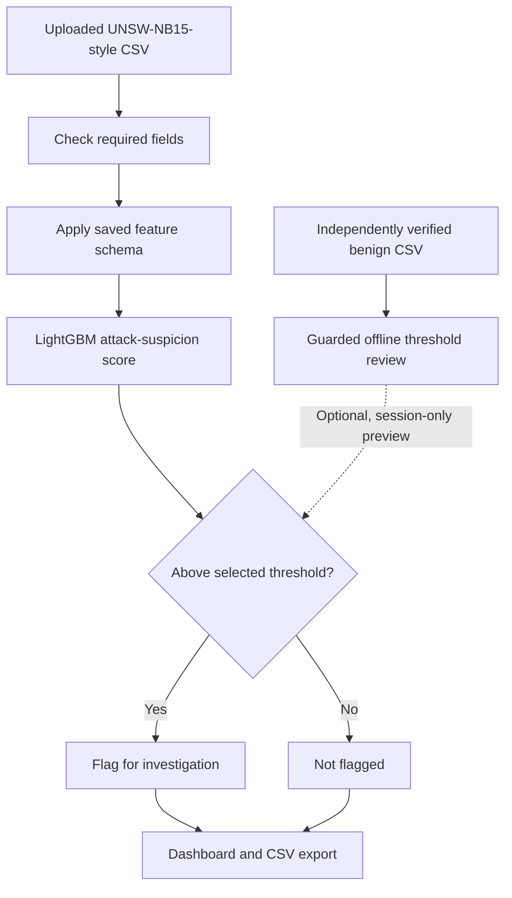

# 🛡️ ZeroGuard AI

### Machine Learning-Powered Network Threat Analytics

**ZeroGuard AI** is a hands-on Python + machine learning project that turns prepared network-flow CSV files into an interactive threat-analysis dashboard. It scores flows using a **LightGBM classifier**, highlights records for investigation, visualizes suspicious activity, and exports annotated results.

[](https://zeroguard-ai.streamlit.app/)
[](https://www.python.org/)
[](https://lightgbm.readthedocs.io/)

**[Try the live app](https://zeroguard-ai.streamlit.app/)** · **[Browse the code](https://github.com/raihan-sk/ZeroGuard-AI)**

> **Project scope:** This is a portfolio and learning project for **batch analysis of uploaded network-flow data**, not live packet capture, automated blocking, or a production security system. A flagged flow is a lead to investigate, not confirmation of an attack.

## ✨ What it can do

- **Score uploaded network flows:** classify prepared UNSW-NB15-style CSV records with a trained LightGBM model.
- **Explore threat indicators:** inspect detection-score distributions, alert share, protocol breakdowns, and alert share across sequential file batches.
- **Investigate alerts:** sort and filter flows, including a flagged-only view.
- **Export results:** download a scored CSV with investigation flags and CSV-formula-safe string handling.
- **Evaluate labeled samples:** display FPR and attack recall when the upload includes valid labels.
- **Preview alert sensitivity:** review a candidate threshold using **independently verified benign traffic**, with guard checks and an explicit session-only preview. It never permanently updates the deployed model.
- **Check the expected input:** download a header-only CSV template from the app.

## 🚀 Quick start

### Try online

Visit **https://zeroguard-ai.streamlit.app/**, open **Traffic Explorer**, and upload a CSV containing the trained input features. You can find a list of required columns and a downloadable header template in the app.

**Note:** The template contains column names only. It is not a sample dataset; fill it with compatible, authorized network-flow values before uploading.

### Run locally

You'll need **Python 3.11** and a trusted copy of the model bundle included in the repository.

```bash
git clone https://github.com/raihan-sk/ZeroGuard-AI.git
cd ZeroGuard-AI
python3.11 -m venv .venv
source .venv/bin/activate            # macOS / Linux
# On Windows: .venv\Scripts\activate
python -m pip install -r requirements.txt
python -m streamlit run dashboard/app.py
```

Open `http://localhost:8501` if it does not open automatically. On Linux, LightGBM may need the OpenMP runtime listed in `packages.txt`; on macOS, install a compatible OpenMP runtime if LightGBM requests it.

## 🧭 How it works



The **currently deployed version uses one saved LightGBM classifier**. Experiments with additional models and feature routing are separate; they are **not** silently enabled in the live app. Model scores should not be interpreted as verified exploit probabilities.

## 📂 Input data

- **Format:** `.csv` with the **42 trained UNSW-NB15-style feature columns**. Column names must match the model bundle.
- **Optional metadata:** `label` (0 = benign, 1 = attack) and `attack_cat` for labeled evaluation. They are not used to calculate predictions.
- **Upload limits:** 25 MB maximum file size in application logic; the **first 10,000 rows** are analyzed.
- **Privacy:** upload only traffic records you are authorized to share. Avoid uploading private or sensitive network logs to a public demo.

If you have the original UNSW-NB15 training CSV locally, you can create a small **illustrative** upload without committing the source dataset to GitHub:

```bash
mkdir -p demo
python - <<'PY'
import pandas as pd
source = pd.read_csv('data/raw/UNSW_NB15_training-set.csv')
source.sample(n=min(200, len(source)), random_state=42).to_csv('demo/sample_flows.csv', index=False)
print('Created demo/sample_flows.csv')
PY
```

This sample is **for demonstrating the interface**, not measuring generalization or independent model accuracy. Check the dataset's usage terms and avoid publishing raw dataset samples without permission.

## 🛠️ Tech stack

**Python** · **Streamlit** · **LightGBM** · **scikit-learn** · **Pandas** · **NumPy** · **Altair** · **SciPy** · **Joblib**

## 🗂️ Project layout

```text
ZeroGuard-AI/
├── dashboard/
│   └── app.py                 # Streamlit UI
├── src/
│   └── zeroguard_engine.py    # Batch scoring and threshold-review logic
├── models/
│   └── zeroguard_deploy.joblib # Trusted model bundle
├── .streamlit/                # Theme / deployment configuration
├── requirements.txt
├── packages.txt
└── README.md
```

## 🧪 What I explored while building it

I used **UNSW-NB15** to practice model training, binary detection, leave-one-attack-family-out evaluations, threshold calibration, and stress tests involving distribution drift and missing features. I also explored **ToN_IoT** to understand how much model behavior changes between network datasets.

These experiments taught me that **high recall, a low false-positive rate, and cross-dataset reliability are different goals**. For example, offline UNSW-NB15 experiments targeting 1% calibration FPR produced approximately 3.2% FPR on the official testing partition. Other experiments used newly trained models and do not represent the live demo's performance.

I keep that distinction explicit: **the app is a functioning ML dashboard, while experimental results are not production guarantees**.

## 📸 Demo and portfolio

For a quick walkthrough, show: **CSV upload → scored dashboard → protocol chart → flagged-only investigation → CSV export**. Add a real screenshot or short screen recording of your running app here when available; do not use a fabricated performance screenshot.

## ⚠️ Limitations

- Batch upload only; no continuous network capture, packet inspection or automated blocking.
- Requires compatible UNSW-NB15-style inputs; another dataset cannot be uploaded without verified feature alignment.
- Attack-suspicion scores are not proof of malicious activity or calibrated exploit probabilities.
- Threshold review is a guarded, optional preview and does not persist or automatically modify the deployed classifier.
- Existing experiments do not prove universal zero-day detection or production readiness.

## 📚 Data acknowledgment

This project uses the **[UNSW-NB15 dataset](https://research.unsw.edu.au/projects/unsw-nb15-dataset)** for development. Additional learning experiments used [ToN_IoT](https://research.unsw.edu.au/projects/toniot-datasets). Dataset creators retain their respective rights and acknowledgments.

---

**Made as a practical machine learning + cybersecurity portfolio project.**

🔗 **[Live Demo](https://zeroguard-ai.streamlit.app/)** · **[GitHub Repository](https://github.com/raihan-sk/ZeroGuard-AI)**
